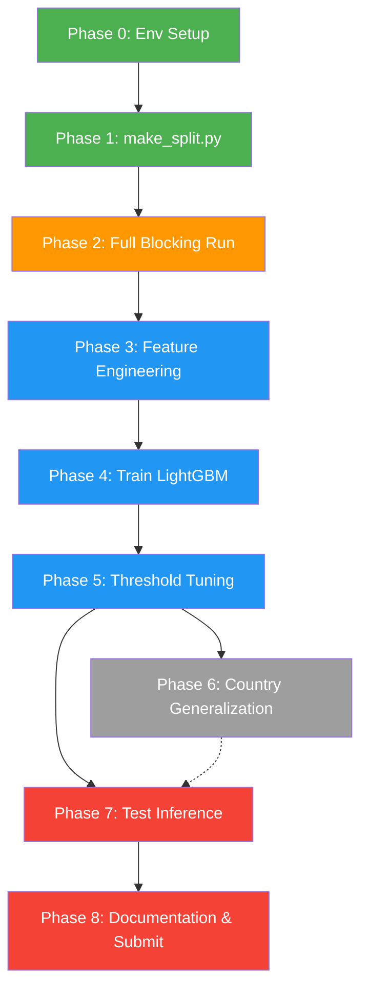

# Amazon ML Challenge 2026 — Implementation Plan

## Current Status Summary

| Phase | Status |
|---|---|
| EDA | ✅ Done |
| Blocking logic (v2 w/ IDF + address keys) | ✅ Done & validated at ~95% recall |
| `scorer.py` (F₀.₅) | ✅ Exists (basic — needs review) |
| Full-scale blocking run | ❌ Incomplete (partial India run killed) |
| `make_split.py` | ❌ Not started |
| Feature engineering | ❌ Not started |
| Matching model (LightGBM) | ❌ Not started |
| Threshold tuning | ❌ Not started |
| Test set inference & output generation | ❌ Not started |
| Documentation | ❌ Not started |

> [!IMPORTANT]
> The dataset lives in `d:\amazon ML challenge\student_resource\dataset\` but the code repo is in `d:\amazon ML challenge\amaon_ml\`. The `run_full_blocking.py` expects to run from `student_resource/` root. We need to reconcile paths or symlink the dataset.

---

## Execution Plan — 8 Phases

### Phase 0: Environment & Path Setup
**Goal:** Get a working environment with all dependencies and correct paths.

1. Create a Python venv inside `student_resource/`
2. Install dependencies: `pandas numpy scikit-learn lightgbm rapidfuzz sentence-transformers faiss-cpu jellyfish tqdm xgboost`
3. Copy/symlink the code from `amaon_ml/code/` into `student_resource/code/` (or adjust paths in scripts to point to the dataset)
4. Delete the partial `train_candidate_pairs_India.tsv` if it exists
5. Verify `scorer.py` — the existing one is minimal but functional; confirm it handles singletons correctly (predict empty + truth empty → 1.0)

**Estimated time:** 15 minutes

---

### Phase 1: `make_split.py` — Stratified Train/Val Split
**Goal:** Create a reproducible validation split to evaluate everything downstream.

**Design:**
- Split Source-1 entity IDs (not individual records) into train/val (80/20)
- Stratify by: **(a)** country, **(b)** singleton vs. has-matches
- Save split as two files: `split_train_s1_ids.txt` and `split_val_s1_ids.txt`
- The split is on S1 IDs only — all S2/S3 records remain available as the candidate pool

**Key decisions:**
- 80/20 split ratio (enough val entities for stable macro-average)
- Random seed = 42 for reproducibility

**Output:** `code/business_entity_resolution/src/make_split.py`

**Estimated time:** 30 minutes

---

### Phase 2: Full-Scale Blocking (Candidate Generation) on Training Data
**Goal:** Run blocking on the FULL training set to produce `train_candidate_pairs.tsv`.

> [!WARNING]
> This is a multi-hour run (~5-7 hours for both countries). Your teammate's run crashed due to RAM. We need to assess your machine's RAM before starting.

**Steps:**
1. Check available RAM on your machine (`systeminfo` or Task Manager)
2. Run India partition first (smaller): `python code\business_entity_resolution\src\run_full_blocking.py --country India`
3. Monitor file growth + memory as described in HANDOFF Section 5
4. Run US partition after India completes: `python code\business_entity_resolution\src\run_full_blocking.py --country US`
5. Merge both partition outputs into a single `train_candidate_pairs.tsv`
6. Validate recall numbers from the auto-generated summary report

**Fallback if RAM is tight:** Reduce `STREAM_MAX_POSTING` from 300 → 150–200, or run on a smaller sample first to validate.

**Alternative (faster) approach:** If RAM is very limited, we can run blocking **only on the val split** (e.g., ~440k S1 entities) which would be much faster and sufficient for training the downstream model, then run full blocking on the test set for final submission.

**Estimated time:** 5–7 hours (can run overnight)

---

### Phase 3: Feature Engineering
**Goal:** For every (S1, candidate) pair from blocking, compute similarity features for the matching model.

**Features to compute (per pair):**

| # | Feature | Library | Notes |
|---|---------|---------|-------|
| 1 | `name_levenshtein` | rapidfuzz | Normalized Levenshtein distance on cleaned names |
| 2 | `name_jaro_winkler` | jellyfish | Jaro-Winkler similarity |
| 3 | `name_token_sort_ratio` | rapidfuzz | Token-sort ratio (handles word reordering) |
| 4 | `name_token_set_ratio` | rapidfuzz | Token-set ratio (handles subset names) |
| 5 | `name_jaccard` | custom | Jaccard similarity on name token sets |
| 6 | `name_tfidf_cosine` | sklearn | Char n-gram TF-IDF cosine (reuse vectorizer from blocking) |
| 7 | `addr_levenshtein` | rapidfuzz | Normalized Levenshtein on addresses |
| 8 | `addr_token_overlap` | custom | |token intersection| / |token union| on address tokens |
| 9 | `addr_number_match` | custom | Do extracted numbers from addresses match? (binary) |
| 10 | `country_exact` | custom | Binary: same country string? |
| 11 | `name_len_ratio` | custom | min(len_a, len_b) / max(len_a, len_b) |
| 12 | `addr_len_ratio` | custom | Same for address |
| 13 | `num_shared_blocking_keys` | blocking.py | Count of shared blocking keys between the pair |
| 14 | `ann_cosine_score` | FAISS embeddings | Cosine similarity from the ANN embedding space |

**Output:** `code/business_entity_resolution/src/feature_engineering.py`
- Produces `train_features.parquet` (or `.tsv`) with columns: `s1_id, candidate_id, label, feature_1, ..., feature_N`
- Label = 1 if candidate is in ground truth matches, 0 otherwise

**Estimated time:** 2–3 hours (code: 1h, running on full data: 1–2h)

---

### Phase 4: Train the Matching Model (LightGBM)
**Goal:** Train a binary classifier on the engineered features to predict match/non-match.

**Design:**
- Model: **LightGBM** (MIT license, trivially under 8B params)
- Train on the train-split pairs, validate on val-split pairs
- Use `label_is_match` as binary target
- Handle class imbalance: most candidates are non-matches → use `scale_pos_weight` or `is_unbalance=True`

**Steps:**
1. Load train-split features
2. Train LightGBM with reasonable defaults
3. Evaluate on val-split using the **macro-averaged F₀.₅** (not accuracy!)
4. Log feature importances

**Output:** `code/business_entity_resolution/src/train_model.py`
- Saves model to `code/business_entity_resolution/src/model.lgb`

**Estimated time:** 1–2 hours

---

### Phase 5: Threshold Tuning for F₀.₅
**Goal:** Find the optimal decision threshold that maximizes macro-averaged F₀.₅ on validation data.

**Design:**
- Get predicted probabilities on val set
- Sweep thresholds from 0.1 to 0.9 in steps of 0.01
- For each threshold: convert probabilities → binary predictions → group by S1 → compute macro F₀.₅
- Pick the threshold with highest macro F₀.₅ (will likely be >0.5 since F₀.₅ is precision-heavy)

> [!TIP]
> The optimal threshold will almost certainly be **above 0.5** (e.g., 0.6–0.8) because F₀.₅ penalizes false positives more than false negatives.

**Output:** Logged optimal threshold, saved in model config.

**Estimated time:** 30 minutes

---

### Phase 6: Held-Out Country Generalization Test
**Goal:** Verify the pipeline doesn't break on unseen countries (France in test set).

**Steps:**
1. Train model using only US data
2. Run inference on India data → check F₀.₅ doesn't collapse
3. Vice versa: train on India, test on US
4. If scores are stable, we're country-agnostic ✅
5. If scores drop, investigate which features leak country-specific info

**Estimated time:** 1 hour

---

### Phase 7: Test Set Inference & Final Output
**Goal:** Generate `matching_results.tsv` and `candidate_pairs.tsv` for the test set.

**Steps:**
1. Run blocking on test data (test_source1 vs test_source2 + test_source3) → `candidate_pairs.tsv`
2. Compute features for all test candidate pairs
3. Run trained LightGBM model with tuned threshold → `matching_results.tsv`
4. Ensure **every S1 entity** in `test_source1.tsv` has a row (even singletons with empty matches)
5. Run `python utils/validate_submission.py --matching output/matching_results.tsv --candidate output/candidate_pairs.tsv --test-dir dataset/test`
6. Verify output → `PASS`

**Estimated time:** 3–5 hours (blocking is the bottleneck)

---

### Phase 8: Documentation & Submission Package
**Goal:** Fill in `Documentation_template.md` and prepare the final zip.

**Steps:**
1. Fill in `Documentation_template.md` — much of blocking section from `blocking_failure_analysis.md`
2. Write proper `README.md` in `code/business_entity_resolution/`
3. Pin `requirements.txt`
4. Package as: `<team>_submission.zip` with `output/`, `code/`, `Documentation_template.md`

**Estimated time:** 1 hour

---

## File Map (what we'll create)

```
code/business_entity_resolution/src/
├── blocking.py                  # ✅ EXISTS — locked, don't touch
├── run_full_blocking.py         # ✅ EXISTS — used in Phase 2 & 7
├── eda.py                       # ✅ EXISTS
├── scorer.py                    # ✅ EXISTS — review in Phase 0
├── make_split.py                # 🆕 Phase 1
├── feature_engineering.py       # 🆕 Phase 3
├── train_model.py               # 🆕 Phase 4
├── tune_threshold.py            # 🆕 Phase 5
├── run_test_inference.py        # 🆕 Phase 7 (blocking + matching on test set)
└── model.lgb                    # 🆕 Phase 4 output
```

---

## Questions Before We Start

1. **How much RAM does your machine have?** This determines whether we can run full-scale blocking locally or need to use an alternative strategy (val-only blocking, cloud machine, etc.)
2. **Is there a deadline for this challenge?** This helps prioritize — if tight, we can skip Phase 6 (country generalization test) and go straight to test inference.
3. **Do you have a GPU?** Not critical (LightGBM is CPU-based), but would help if we want to experiment with sentence-transformers embeddings later.
4. **Should I work inside `amaon_ml/` (the cloned repo) or `student_resource/`?** The dataset is in `student_resource/dataset/` and the code is in `amaon_ml/code/`. We need to decide the canonical working directory.

---

## Recommended Execution Order



> **Green** = quick to do now · **Orange** = long-running (overnight) · **Blue** = core ML work · **Gray** = optional but recommended · **Red** = final submission
